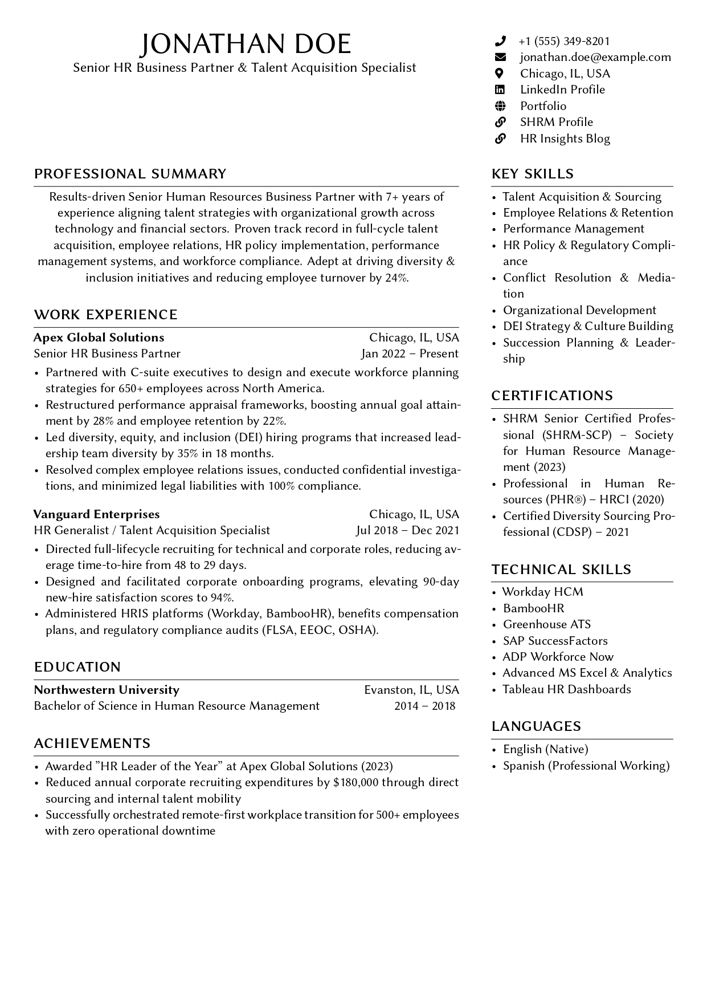

# ResuGen
> **High-Performance, Real-Time LaTeX Resume Builder**  
> Generate pristine, ATS-friendly resumes compiled with native LaTeX in real time.

[](https://angular.io/)
[](https://spring.io/projects/spring-boot)
[](https://www.oracle.com/java/)
[](https://tectonic-typesetting.github.io/)
---

## Overview

**ResuGen** is a modern, full-stack web application that allows engineers, recruiters, and professionals to build and manage professional, beautifully typeset resumes without wrestling with complex LaTeX markup.

It combines an intuitive, distraction-free visual builder with real-time compilation: as you type, changes are compiled into an authentic vector PDF rendered side-by-side with an interactive previewer.

### Key Highlights

- **Dual Career-Track Templates**:
  - **Software Development Engineer (SDE)**: Single-column classic tech CV optimized for software developers, tech stacks, live project demos, and GitHub repositories.
  - **Human Resources / Executive (HR)**: Two-column executive CV (70% main timeline, 30% sidebar) tailored for HR professionals, recruiters, and organizational leaders.
- **Instant Real-Time Preview**: Fast debounce-driven compilation with client-side caching (0ms switching between previously compiled states).
- **ATS-Friendly Output**: Generates pure vector PDF files compiled via `tectonic` / `pdflatex`, ensuring maximum readability by Automated Tracking Systems (ATS).
- **🎛Drag-and-Drop Organization**: Reorder sections dynamically, adjust spacing, and toggle section visibility on the fly.
- **Custom Hyperlinks**: Add custom social, portfolio, and profile links (e.g., LeetCode, Codeforces, Kaggle, personal website).
- **Refined Black & Yellow Theme**: Clean, professional design system with native Light Mode and Dark Mode support (no gradients, WCAG-compliant high-contrast typography).
- **Secure Cloud Synchronization**: JWT-authenticated REST API with MySQL persistence to save, update, and manage multiple resumes.

---

## Screenshots & Showcase

| SDE Technical Track | HR Executive Track |
| :---: | :---: |
|  |  |

---

## Architecture & Tech Stack

```
ResuGen/
├── docs/                     # Sample resumes and preview screenshots
├── rg-backend/               # Spring Boot 3 REST API (Java 17, Spring Security, MySQL)
│   ├── src/main/java/        # Controllers, Security, JWT, DTOs, Services
│   ├── src/main/resources/   # Database configuration (application.properties)
│   ├── Dockerfile            # Container definition for backend
│   └── pom.xml               # Maven dependencies
├── rg-frontend/              # Angular 15 Single Page Application
│   ├── compiler/             # Embedded LaTeX compilation microservice (Port 8888)
│   │   ├── bin/tectonic.exe  # Standalone LaTeX compiler engine (Windows)
│   │   └── server.js         # HTTP compilation sync server
│   ├── src/app/              # Angular components, reactive forms, LaTeX services
│   ├── src/assets/           # Track preview images & branding
│   ├── start-app.js          # Unified launcher (Compiler + Frontend)
│   └── package.json          # Frontend scripts & dependencies
└── README.md                 # Project documentation
```

### Components

- **Frontend**: Angular 15, Angular CDK (Drag & Drop), Bootstrap 5 utility classes, Google Material Symbols, RxJS.
- **Backend API**: Spring Boot 3.x, Spring Security 6, JWT (`io.jsonwebtoken`), Spring Data JPA, Hibernate, MySQL.
- **Compiler Microservice**: Node.js HTTP server executing standalone `tectonic` (XeTeX engine), accepting raw LaTeX payload and streaming back compiled binary PDFs.

---

## Two Versions Available

ResuGen is architected to run seamlessly in two modes:

| Mode | Where it Runs | Frontend URL | Compiler Service | Setup Needed |
| :--- | :--- | :--- | :--- | :--- |
| **Production** | Netlify + Render Cloud | [resugen-rg.netlify.app](https://resugen-rg.netlify.app) | Hosted on Render (`resugen-compiler.onrender.com`) | **None** (Ready to use instantly) |
| **Local Cloned** | Your Local Machine | `http://localhost:4200` | Bundled Local Engine (`http://localhost:8888`) | **1 command** (`npm start`) |

---

## Running ResuGen Locally (Just by Cloning)

You can clone and run ResuGen locally on your machine with **zero Java or MySQL configuration**. The local frontend connects to the cloud backend for user accounts and uses your machine's local CPU for **blazing-fast LaTeX compilation (< 1 second)**.

### Quick Start (One Command)

#### 1. Clone the Repository
```bash
git clone https://github.com/Ashish110411/Resugen.git
cd Resugen
```

#### 2. Start All Services Locally
Run the launcher from the project root:

- **Windows (Command Prompt / PowerShell)**:
  ```cmd
  start.bat
  ```
  *(or simply double-click `start.bat` in File Explorer)*

- **Any OS (Node.js)**:
  ```bash
  npm start
  ```
  *(or `node start.js`)*

- **Linux / macOS**:
  ```bash
  ./start.sh
  ```

> ⚡ **What happens automatically:**
> - Automatically installs dependencies if running for the first time.
> - Starts the local high-speed LaTeX Compiler on port `8888` (sub-second compile time).
> - Starts the Angular dev server on port `4200` (`http://localhost:4200`).
> - Automatically connects to the cloud backend for user accounts and storage (no Java/MySQL required).
> - Press `Ctrl+C` to cleanly shut down all services.

---

### Optional: Running Full-Stack Locally (with Local Backend & MySQL)

If you want to run the Spring Boot backend and MySQL completely offline on your machine:

1. **Prerequisites**: Java 17+, Maven 3.8+, MySQL Server running on port `3306`.
2. **Create Database**:
   ```sql
   CREATE DATABASE IF NOT EXISTS resugen_db;
   ```
3. **Run with `--full`**:
   ```bash
   node start.js --full
   ```
   *(or `npm run start:full` or `start.bat --full`)*
   This launches the Spring Boot backend (port 7777), the LaTeX compiler (port 8888), and the Angular frontend (port 4200) simultaneously!
4. **Switch Frontend to Local Backend**:
   In `rg-frontend/src/environments/environment.ts`, set:
   ```typescript
   const USE_LOCAL_BACKEND = true;
   ```

---

### Step 5: Open the Application

Navigate to **`http://localhost:4200`** in your browser.

1. Click **Get Started** or **Sign In**.
2. Create a new account via the **Create Account** page.
3. Choose your resume track:
   - **SDE Resume** (Technical 1-Column)
   - **HR Resume** (Executive 2-Column)
4. Customize your personal details, experience, skills, and section ordering.
5. Click **Download PDF** to export your ATS-ready resume or **Copy LaTeX** for manual compilation on Overleaf.

---

## Configuration & Port Summary

| Service | Port | Description |
| :--- | :---: | :--- |
| **Angular Frontend** | `4200` | UI, form builders, and live PDF viewer |
| **Spring Boot Backend** | `7777` | REST API (Authentication, Resume CRUD) |
| **LaTeX Compiler** | `8888` | Local Tectonic compilation server |
| **MySQL Database** | `3306` | Persistent storage for users and resumes |

---

## Testing & Building for Production

### Frontend Production Build
```bash
cd rg-frontend
npm run build
```
Compiled output will be placed in `rg-frontend/dist/rg-frontend`.

### Backend JAR Packaging
```bash
cd rg-backend
mvn clean package -DskipTests
```
The executable JAR will be located at `rg-backend/target/rg-backend-0.0.1-SNAPSHOT.jar`.

---

## Author & Connect

**Ashish Chaudhary**

- **GitHub**: [@Ashish110411](https://github.com/Ashish110411)
- **LinkedIn**: [Ashish Choudhary](https://www.linkedin.com/in/ashish110411/)
- **Portfolio**: [ashish110411.netlify.app](https://ashish110411.netlify.app/)
- **Email**: [ashishchaudhary110411@gmail.com](mailto:ashishchaudhary110411@gmail.com)
- **Star this Repository**: [github.com/Ashish110411/Resugen](https://github.com/Ashish110411/Resugen)

---

## License

This project is licensed under the MIT License - feel free to use it for personal and commercial projects.
